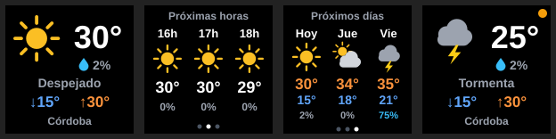
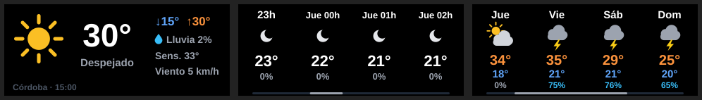

# Clima Open-Meteo para Redragon SS-552 / StreamDock

Plugin de clima para la **Redragon SS-552 Ragnaros** (y otros dispositivos compatibles con **StreamDock**), con datos de [Open-Meteo](https://open-meteo.com) consultados por **coordenadas exactas**.





## Por qué otro plugin de clima

El plugin de clima de StreamDock busca la ciudad por nombre en un servidor intermedio y muestra la lista **sin provincia ni país**. Al buscar "Córdoba" aparecen varias entradas idénticas y la primera es Córdoba, España. Este plugin:

- Muestra cada resultado con **provincia y país** ("Córdoba, Provincia de Córdoba, Argentina").
- Guarda **latitud y longitud**, no un nombre ambiguo.
- Consulta directamente a Open-Meteo, una fuente pública, gratuita y sin clave de API.

## Qué muestra

**Tecla** (pulsá para cambiar de vista; a los 30 s vuelve sola a "ahora"):

| Vista | Contenido |
|---|---|
| Ahora | Ícono, temperatura, probabilidad de lluvia del día, condición, mínima y máxima, ciudad |
| Próximas horas | Las 3 horas siguientes: ícono, temperatura y probabilidad de lluvia |
| Próximos días | Hoy y los 2 días siguientes: ícono, máxima, mínima y lluvia |

**Perilla** (vuelve sola a "ahora" a los 20 s sin tocarla):

| Acción | Resultado |
|---|---|
| Girar a la derecha | Abre el pronóstico por hora y lo recorre (24 h) |
| Girar a la izquierda | Retrocede; desde la primera hora vuelve a "ahora" |
| Pulsar | Cambia entre ahora → horas → días |

La vista "ahora" de la perilla agrega sensación térmica, viento y la hora de la medición.

Un **punto ámbar** arriba a la derecha indica que la última actualización falló y se están mostrando los datos anteriores. Sin datos, la tecla muestra "Sin conexión"; pulsarla reintenta.

## Instalación

1. Descargá `weather-ss552-vX.Y.Z.zip` de la sección *Releases* y descomprimilo.
2. Hacé doble clic en **`install.cmd`**.

El instalador verifica que StreamDock esté instalado, comprueba el SHA-256 de `weather.exe` contra `SHA256SUMS.txt`, cierra StreamDock y cualquier copia anterior del plugin, instala la nueva versión y vuelve a abrir StreamDock.

Después, en StreamDock:

1. Categoría **Clima Open-Meteo** → arrastrá **Clima (tecla)** a una tecla o **Clima (perilla)** a una perilla.
2. En la configuración, escribí tu ciudad, pulsá **Buscar** y elegí la correcta de la lista.
3. Opcional: unidades (°C / °F) y frecuencia de actualización (10, 15, 30 o 60 minutos).

Varias teclas o perillas con la misma ciudad comparten una sola consulta.

Para desinstalar: `uninstall.cmd`.

## Problemas comunes

- **"Sin conexión"**: no se pudo llegar a Open-Meteo. Pulsá la tecla para reintentar; si persiste, revisá `%APPDATA%\HotSpot\StreamDock\plugins\com.marco.weather.sdPlugin\weather.log`.
- **La búsqueda no encuentra la ciudad**: probá solo el nombre, sin provincia ni país ("Villa Carlos Paz", no "Villa Carlos Paz, Córdoba").
- **El antivirus marca `weather.exe`**: los ejecutables de Go sin firma digital a veces generan falsos positivos. Verificá el SHA-256 con el de la release o compilalo vos mismo.

## Cómo funciona

`weather.exe` es un ejecutable en **Go** que StreamDock inicia y con el que se comunica por WebSocket (SDK de StreamDock / Stream Deck v1). Descarga el pronóstico de `api.open-meteo.com` (actual, 7 días por hora y por día) y dibuja cada pantalla como SVG. La búsqueda de ciudades usa `geocoding-api.open-meteo.com` y la hace el propio ejecutable, a pedido del panel de configuración.

Si una actualización falla, reintenta a los 30 s, 1, 2, 4… hasta un máximo de 10 minutos entre intentos, sin dejar de mostrar los últimos datos.

Solo usa la biblioteca estándar de Go, sin dependencias de terceros.

## Desarrollo

Requiere Go 1.22 o superior.

```bash
go test -race ./...           # Unit and end-to-end tests (fake StreamDock and fake Open-Meteo)
./scripts/build.sh            # Cross-compiles weather.exe and builds the release zip (Linux/macOS)
./scripts/gen-images.sh       # Regenerates the plugin PNGs from the renderer (needs rsvg-convert)
```

```powershell
.\scripts\build.ps1           # Builds on Windows
```

Estructura:

```
cmd/weather/               # Entry point: launch arguments, event loop, city search
internal/weather/          # Open-Meteo client, forecast and geocoding parsing
internal/plugin/           # Settings, shared forecast cache with backoff, per-key views
internal/render/           # Key and knob screens and weather icons as SVG
internal/streamdock/       # Minimal WebSocket client and StreamDock protocol
com.marco.weather.sdPlugin/  # Manifest, settings panel and images (the build adds weather.exe)
testdata/                  # Real Open-Meteo responses used by the tests
tools/genassets/           # Writes the SVG sources of the static images
```

## Créditos

- Datos meteorológicos: [Open-Meteo](https://open-meteo.com) (licencia CC BY 4.0).
- [Documentación del SDK de StreamDock](https://sdk.key123.vip/en/guide/overview.html).

Proyecto independiente, sin relación con Redragon, Mirabox ni Open-Meteo.

## Licencia

[MIT](LICENSE)
